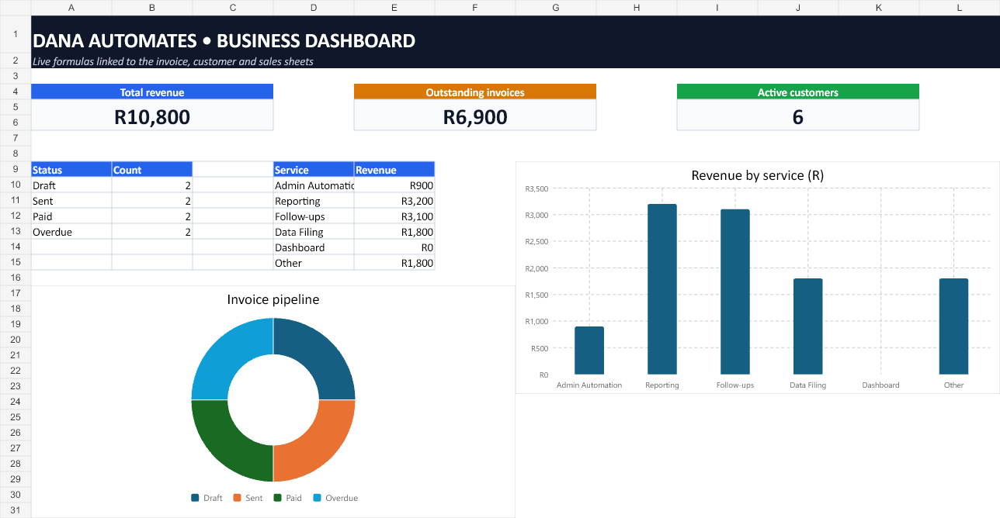

<div align="center">

# ⚡ Dana Automates

### Practical automation for small businesses

Invoices chased. Reports built. Spreadsheets cleaned. Follow-ups sent.

[](https://dana-automates.therondana65.workers.dev)
[](automations/)
[](tests/)
[](https://workers.cloudflare.com/)

[Website](https://dana-automates.therondana65.workers.dev) · [Automation Guide](automations/README.md) · [Excel Demo](examples/dana-automates-business-demo.xlsx) · [Source Code](automations/) · [Contact](mailto:therondana65@gmail.com)

</div>

---

**Dana Automates** is a South African freelance automation project focused on removing repetitive admin from small businesses. The repository contains the live portfolio website, working Python examples, automated tests, realistic sample data, and a formula-driven Excel demonstration.

The goal is simple: **turn a task someone repeats every week into a reliable workflow they can run in one click—or no clicks.**

## Showcase

<p align="center">
  <a href="examples/dana-automates-business-demo.xlsx">
    
  </a>
</p>

The Excel demo represents an honest starter business: **8 clients, 6 active clients and R10,800 in sample revenue**. Its formulas, charts, status controls and conditional highlighting update from the underlying invoice, customer and sales sheets.

> **[Download the interactive Excel workbook →](examples/dana-automates-business-demo.xlsx)**

## Why Dana Automates

- Small businesses lose hours to copying, chasing, renaming and reporting.
- Most of those workflows do not need expensive enterprise software.
- Every build starts in safe preview mode before messages or files are changed.
- Clients receive the source code, plain-English setup notes and no forced subscription.
- Examples use free, accessible tools wherever practical.

## Working automations

| Automation | What goes in | What comes out | Code |
|---|---|---|---|
| **Invoice reminders** | Invoice CSV export | Personalised previews for overdue accounts | [`invoice_reminders.py`](automations/invoice_reminders.py) |
| **Spreadsheet cleanup** | Messy customer list | Normalised, deduplicated CSV | [`spreadsheet_cleanup.py`](automations/spreadsheet_cleanup.py) |
| **Weekly sales report** | Sales CSV export | Revenue, order count, average value and top category | [`weekly_report.py`](automations/weekly_report.py) |

### Invoice reminder flow

```text
invoice export
      ↓
validate status + due date
      ↓
find overdue unpaid invoices
      ↓
build personalised reminder previews
      ↓
human approval before sending
```

### Example code

```python
from datetime import date
from automations.invoice_reminders import build_reminders, find_overdue_invoices

overdue = find_overdue_invoices(invoices, today=date.today())
previews = build_reminders(overdue)

for reminder in previews:
    print(reminder["to"], reminder["subject"])
```

The included example deliberately **does not send emails**. A production version connects the approved final step to Outlook, Gmail or the client's existing system.

## Quick start

Requirements: Python 3.11 or newer. No paid API or package installation is required.

```powershell
git clone https://github.com/Dana-GrootSeun/Dana-Automations.git
cd Dana-Automations
python -m unittest discover -s tests -v
```

Run an automation with the sample data:

```powershell
# Preview overdue invoice reminders
python -m automations.invoice_reminders examples/invoices.csv

# Clean and deduplicate a customer list
python -m automations.spreadsheet_cleanup examples/customers.csv output/clean-customers.csv

# Generate a weekly sales summary
python -m automations.weekly_report examples/sales.csv
```

## How client projects work

1. **Map the task** — identify the manual steps, files and rules.
2. **Fix the scope** — agree on the exact input, output, price and delivery date.
3. **Build safely** — use anonymised data and keep external actions in preview mode.
4. **Demo on real data** — verify the workflow before switching it on.
5. **Hand over** — provide the code, setup guide and two weeks of fixes.

## Repository map

```text
Dana-Automations/
├── automations/                  # Working Python automation modules
│   ├── invoice_reminders.py
│   ├── spreadsheet_cleanup.py
│   └── weekly_report.py
├── assets/                       # README showcase images
├── examples/                     # Sample CSVs + interactive Excel workbook
├── tests/                        # Automated behaviour tests
├── index.html                    # Live portfolio website
├── _headers                      # Cloudflare security headers
└── README.md
```

## Technology

| Layer | Tools |
|---|---|
| Automation | Python standard library, CSV workflows |
| Website | HTML5, CSS3, vanilla JavaScript |
| Reporting | Excel formulas, tables, validation and charts |
| Testing | Python `unittest` |
| Hosting | Cloudflare Workers static assets |
| Version control | Git and GitHub |

## Roadmap

- [x] Live portfolio website
- [x] Invoice reminder previews
- [x] Customer spreadsheet cleanup
- [x] Weekly sales summary
- [x] Interactive Excel business dashboard
- [ ] Real enquiry delivery from the website contact form
- [ ] Outlook/Gmail adapter with approval step
- [ ] Scheduled weekly report delivery
- [ ] First anonymised client case study

## Safety and privacy

Sample names, email addresses and business records in this repository are fictional. Production work should use minimum required access, anonymised development data, explicit approval before external sends, and credentials stored outside source control.

## Contact

Have a repetitive task that should run itself?

**[Visit the website](https://dana-automates.therondana65.workers.dev)** · **[Email Dana](mailto:therondana65@gmail.com)**

---

<div align="center">

Built by **Dana Theron** in South Africa 🇿🇦

</div>
